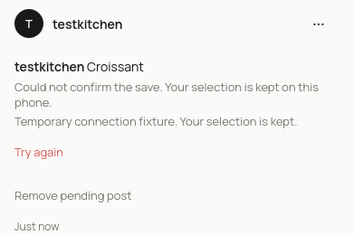

# Immediate durable barcode and food-search posting

## Method

Account1, Chromium131 at390×844, actual current DevTools Fast4G165ms/1012500B/s down/168750B/s up, CPU4. Production baseline uses three actual posts per path. Disposable built-app after trials use the same network/CPU profile and generated UPC016000275683 camera fixture; local FDC reference/correction fixtures are scripted and explicitly do not prove real product recognition. Every after post was confirmed ready through actual HTTP/Postgres. Objects, posts, operation receipts and prior local cap/cache/correction state were scoped and restored.

## Results

| Path | Production baseline tap→close | Disposable after tap→close | Image body bytes per trial |
|---|---|---|---|
| Barcode |4653.7 /3766.0 /3700.7ms|176.5 /75.6 /92.2ms|39940B in4 PUTs →19970B in2 PUTs|
| Food search |2606.7 /3735.8 /3763.2ms|170.1 /106.8 /131.1ms|0 →0|

These after values are local, not final production acceptance. Server host timings differ; the new close boundary is the durable local checkpoint and does not await a server response.

Actual disposable browser failures also passed:

- Hold food POST before the backend: sheet closes and pending Feed entry appears while the operation table still has no row.
- Commit the real POST, then abort its browser response: retry replays one ready post, with one item.
- Refuse all three attempts: selection survives reload and is hidden from account2; returning account1 retries the same operation successfully.
- Lose all three successful responses: Remove pending post atomically hides the already committed post; replay returns410 and cannot resurrect it.

The screenshots are the exact0e70ecd preview renderer with POST intercepted before backend, not a claim of production SQL success. Its search-result tap→close was176.2ms; three scripted503 replies retained the selection. Real backend behavior is separately covered by disposable HTTP/DB/browser checks.

## Answer

Barcode and food-search taps now publish a pending result after durable IndexedDB storage. Retry and reload retain identity, portion, time and pack file. Server acknowledgement supplies the actual post ID; nutrition stays server-resolved. Safe removal uses the publication lock and a tombstone instead of silently discarding a possibly committed operation.

## Unknown and release boundary

Migration0043 is required before the new client reaches production. This agent applied it only to disposable local Postgres. Final merged production trials remain required. These are browser simulations, not physical-camera measurements. Pending/failure screenshots deliberately use intercepted writes; they create no production food post. Private raw receipts are under uploads/run10-performance/fix306-{local-after,local-failures-v3}-posting and fix306-preview-renderer.
