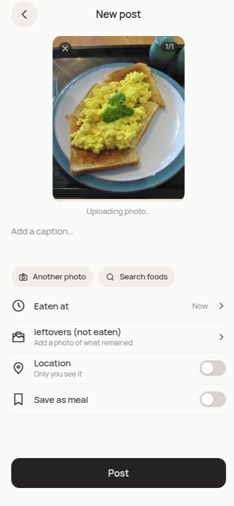
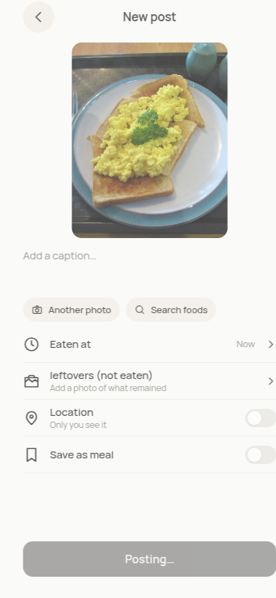

# Camera first-paint comparison

Measured 2026-11-03T09:50:53.382Z. Actual frozen meal fixture1280×960 supplied through a canvas camera. The fixture is drawn once; a one-pixel identical redraw/requestFrame keeps10fps without repeatedly copying the full source on the app main thread. 390×844, CPU4×, custom150ms/200000B/s down/93750B/s up. This is not the current DevToolsFast4G preset. POST /api/posts was blocked, so no fixture draft/upload/modelcall was created; this isolates shutter-to-visible-photo, not upload timing.

| Trial | Production before ms | Preview after ms |
| --- | ---: | ---: |
| 1 | 222.2 | 91.3 |
| 2 | 258.7 | 63.9 |
| 3 | 290.3 | 58.5 |
| 4 | 413.4 | 76.7 |
| 5 | 1045.9 | 69.9 |

All five after samples show the actual frozen canvas in58.5–91.3ms. Full-resolution JPEG encoding remains0.95 quality. Screenshots below were actually inspected; the first after screenshot still shows the old Posting label while preparing. A subsequent label-only fix keeps Post disabled without falsely claiming a post has started. The timing applies to the same capture/canvas path; repeat on final production with the exact requested preset remains required. Physical-phone acceptance is not claimed.

